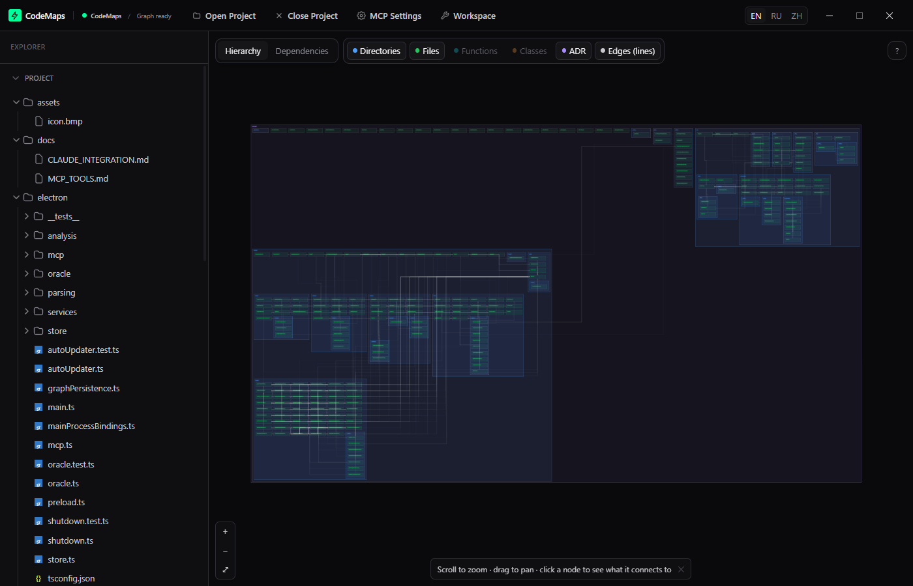
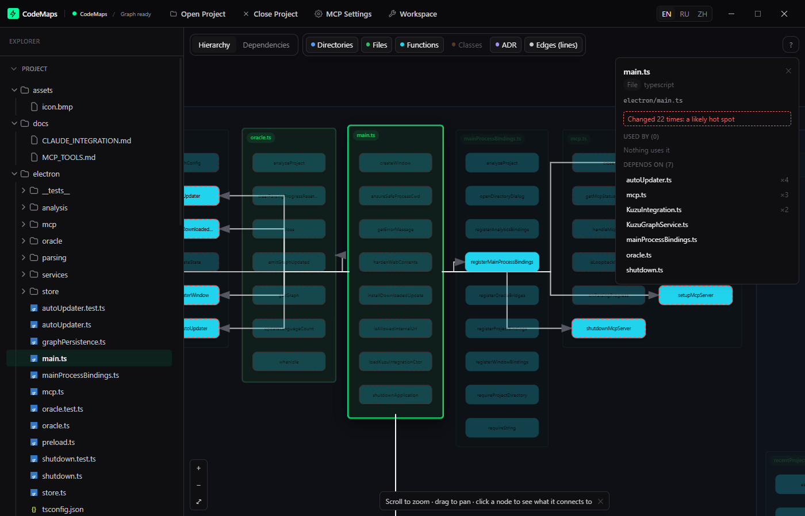
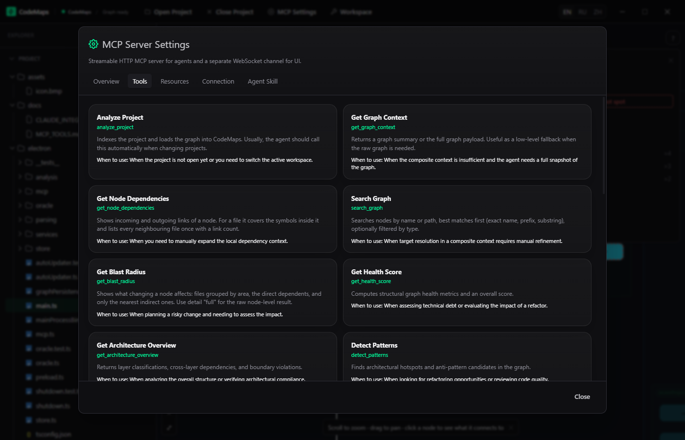

<div align="center">
  

# CodeMaps

**El plano vivo de tu código: un mapa interactivo de dependencias para las personas y un servidor MCP que da a los agentes de IA el contexto arquitectónico para escribir código limpio.**

[](https://github.com/Zilk102/CodeMaps/releases/latest)
[](https://github.com/Zilk102/CodeMaps/actions/workflows/ci.yml)
[](LICENSE)


[🇺🇸 English](README.md) · [🇷🇺 Русский](README.ru.md) · [🇨🇳 简体中文](README.zh-CN.md) · [🇪🇸 Español](README.es.md) · [🇯🇵 日本語](README.ja.md) · [🇰🇷 한국어](README.ko.md)

</div>

CodeMaps indexa un proyecto como un grafo de carpetas, archivos, clases y funciones y de los vínculos entre ellos, y lo ofrece de dos maneras:

- **A las personas**, como un mapa interactivo: quien se incorpora ve qué está conectado con qué y qué depende de un archivo antes de tocarlo.
- **A los agentes de IA** (Claude Code, Claude Desktop, Cursor, Trae y cualquier cliente MCP), como 21 herramientas acotadas que responden a _¿qué se rompe si cambio esto?_, _¿ya existe una función auxiliar para esto?_ y _¿mi cambio añadió un archivo gigante o un clon?_ sin leer todo el repositorio.

Todo se ejecuta en local. El código fuente nunca sale de tu máquina.



## Por qué

Un agente que solo tiene grep y lectura de archivos deambula. CodeMaps le da un mapa del proyecto, el impacto de un cambio y una comprobación de sus propios cambios, en respuestas pequeñas que caben en una ventana de contexto.

|                        | Qué obtienes                                                                                                       |
| ---------------------- | ------------------------------------------------------------------------------------------------------------------ |
| **Orientación**        | Puntos de entrada, capas y límites de un proyecto desconocido en una llamada (`prepare_project_context`).          |
| **Cambios seguros**    | Dependientes directos e indirectos por áreas antes de editar (`get_blast_radius`), incluidas las reexportaciones.  |
| **Código limpio**      | `validate_architecture_changes` revisa solo los archivos que cambiaste: archivos gigantes, clones, métodos largos. |
| **Lectura barata**     | El esqueleto de un archivo sin cuerpos de funciones y con números de línea (`get_semantic_skeleton`).              |
| **Refactor de legado** | Guía de descomposición para módulos enormes y clases God (`analyze_decomposition`).                                |
| **Salida acotada**     | Cada respuesta tiene un tope; lo omitido se indica en `_compaction`, así una llamada no inunda el contexto.        |

## Capturas

Selecciona un archivo y verás sus funciones y de qué depende:



El servidor MCP y sus herramientas, listos para cualquier agente:



## Instalación

Descarga la última versión desde [Releases](https://github.com/Zilk102/CodeMaps/releases/latest):

- **Windows**: instalador (`-setup-x64.exe`), portable (`-win-x64.exe`) o `.zip`
- **Linux**: `.AppImage`, `.deb`, `.rpm` o `.tar.gz`

Aún no se publican versiones para macOS. Node.js 22+ en el `PATH` solo hace falta para las tres herramientas basadas en la base de grafos Kuzu (`calculate_blast_radius_v2`, `analyze_activity_heatmap`, `analyze_pr_impact`); todo lo demás funciona sin él.

CodeMaps guarda una caché derivada en una carpeta `.codemaps/` dentro de cada proyecto analizado; añádela al `.gitignore` de ese proyecto.

## Conectar un agente de IA

Inicia CodeMaps y luego:

```bash
# Claude Code, para todos los proyectos
claude mcp add --transport http --scope user codemaps http://127.0.0.1:3005/mcp
```

- **Claude Desktop** se conecta mediante el puente `mcp-remote`; **Cursor** y **Trae** por URL. Hay fragmentos listos con botón de copiar en la aplicación: **Ajustes MCP → Conexión**.
- Añade la skill `codemaps-agent-autopilot` (`.claude/skills/`) para que el agente empiece con `prepare_task_context`, y el **hook** opcional que valida cada edición automáticamente.

Guía completa: [docs/CLAUDE_INTEGRATION.md](docs/CLAUDE_INTEGRATION.md).

## Lenguajes admitidos

| Soporte         | Lenguajes                                                                            | Qué obtienes                                                             |
| --------------- | ------------------------------------------------------------------------------------ | ------------------------------------------------------------------------ |
| **Semántico**   | TypeScript, TSX, JavaScript                                                          | Importaciones resueltas por el compilador de TypeScript, reexportaciones |
| **Estructural** | Python, Go, Rust, Java, C/C++, C#, PHP, Ruby, Zig, Swift, Kotlin, Bash (tree-sitter) | Declaraciones e importaciones; sin resolución de tipos                   |
| **Limitado**    | HTML, CSS, Vue                                                                       | Archivos y estructura básica                                             |
| **Metadatos**   | Markdown (ADR), YAML                                                                 | Registros de decisiones de arquitectura enlazados al código              |

La precisión de las dependencias entre archivos es mayor en el nivel semántico; en los demás, trata los vínculos como una pista sólida y confírmalos con una búsqueda.

## Documentación

| Documento                                                | Contenido                                                         |
| -------------------------------------------------------- | ----------------------------------------------------------------- |
| [docs/CLAUDE_INTEGRATION.md](docs/CLAUDE_INTEGRATION.md) | Configuración de Claude Code y Desktop, skill, hook de validación |
| [docs/MCP_TOOLS.md](docs/MCP_TOOLS.md)                   | Referencia de las 21 herramientas y 4 recursos (generada)         |
| [docs/ARCHITECTURE.md](docs/ARCHITECTURE.md)             | Cómo está construido CodeMaps y por qué                           |
| [CONTRIBUTING.md](CONTRIBUTING.md)                       | Entorno de desarrollo, comprobaciones, proceso de publicación     |
| [CHANGELOG.md](CHANGELOG.md)                             | Qué cambió en cada versión                                        |

## Desarrollo

```bash
git clone https://github.com/Zilk102/CodeMaps.git
cd CodeMaps
yarn install        # solo se admite yarn
npm run dev         # Vite + Electron
npm run verify      # todo lo que ejecuta CI: lint, formato, tipos, pruebas, compilaciones
npm run mcp:smoke   # llama a cada herramienta MCP en una instancia en ejecución
```

La pila es Electron, React, TypeScript y Vite; el diseño del grafo lo calcula elkjs y el análisis usa tree-sitter y el compilador de TypeScript. Requiere Node.js 22+.

## Contribuir, seguridad, licencia

Lee [CONTRIBUTING.md](CONTRIBUTING.md) antes de abrir un pull request y [SECURITY.md](SECURITY.md) para informar de una vulnerabilidad. Publicado bajo la [licencia MIT](LICENSE).
