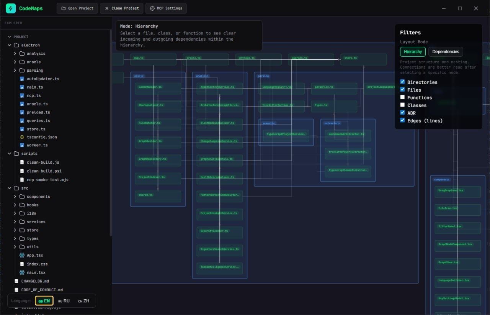
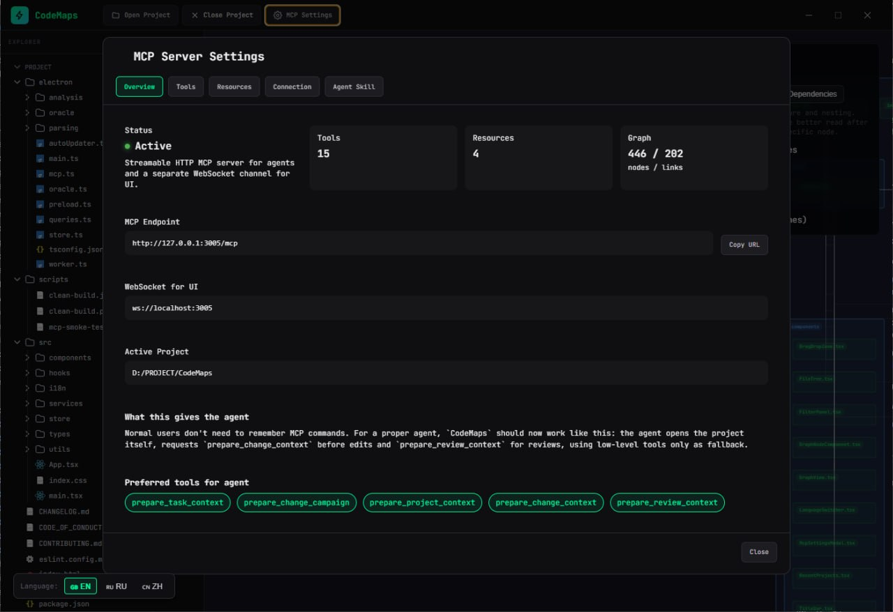
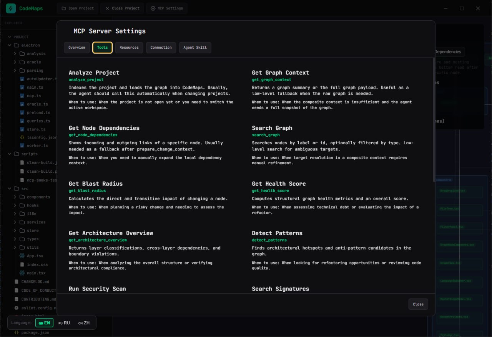
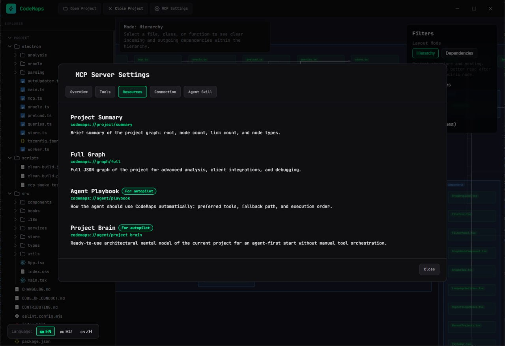

<div align="center">
  <p>
    <a href="README.md">🇺🇸 English</a> | 
    <a href="README.ru.md">🇷🇺 Русский</a> | 
    <a href="README.zh-CN.md">🇨🇳 简体中文</a> | 
    <a href="README.es.md">🇪🇸 Español</a> | 
    <a href="README.ja.md">🇯🇵 日本語</a> | 
    <a href="README.ko.md">🇰🇷 한국어</a>
  </p>
</div>

# CodeMaps

**CodeMaps** is a powerful tool for visualizing codebase architecture and providing architectural context to AI assistants. The application builds a "living" dependency graph of your project, helping developers and neural networks better understand structure, relationships, and technical debt.

## 🚀 Key Features

- **Automated Graph Building**: Deep semantic code analysis (via AST and tree-sitter) to identify relationships between files, classes, and functions.
- **Model Context Protocol (MCP) Integration**: CodeMaps acts as an MCP server, allowing your AI assistants (e.g., Trae, Claude, or Cursor) to "see" the project's architecture, analyze dependencies, and predict the consequences of changes.
- **Architectural Analytics**:
  - **Blast Radius**: Evaluate what will be affected by changing a specific module.
  - **Health Score**: Identify cyclic dependencies and architectural anti-patterns.
  - **Security Scanner**: Basic search for potential vulnerabilities in the code structure.
- **Local Execution**: All analysis happens locally on your machine; source code is never sent anywhere.

---

## 🖼️ Screenshots

### Interactive Code Graph

Visualize your entire codebase as an interactive graph with files, classes, functions, and their relationships.



### MCP Server Settings — Overview

CodeMaps runs an MCP server with HTTP and WebSocket endpoints, providing AI agents with structured access to your project's architecture.



### MCP Tools

21 built-in tools for AI agents: analyze project, get graph context, search nodes, detect patterns, run security scans, and more.



### MCP Resources

Resources provide AI agents with high-level project summaries, full graph exports, and autonomous execution playbooks.



---

## 📦 Installation

Download the portable version from the [Releases](https://github.com/Zilk102/CodeMaps/releases) page.

The application requires no complex installation and works right out of the box on **Windows** and **Linux**. macOS builds are not published yet. Node.js 22+ on `PATH` is needed only for the Kuzu-backed tools (`calculate_blast_radius_v2`, `analyze_activity_heatmap`, `analyze_pr_impact`); everything else works without it.

### Quick Start

```bash
# Download the latest release for your platform
# Windows: CodeMaps-x.x.x-win-x64.exe
# Linux: CodeMaps-x.x.x-linux-x86_64.AppImage (or .deb, .rpm)

# Run it — no installation needed!
```

---

## 🤖 Claude Code & Claude Desktop

Start CodeMaps, then connect it:

```bash
# Claude Code (all projects)
claude mcp add --transport http --scope user codemaps http://127.0.0.1:3005/mcp
```

For Claude Desktop, add an `mcp-remote` bridge to `claude_desktop_config.json`. This repository also ships a project `.mcp.json` and a ready-made `codemaps-agent-autopilot` skill in `.claude/skills/`. An optional Claude Code hook validates every edit through CodeMaps automatically. Full guide: [docs/CLAUDE_INTEGRATION.md](docs/CLAUDE_INTEGRATION.md).

---

## 🛠️ Development

The project is built on the following stack: **Electron + React + TypeScript + Vite**. The graph is rendered as SVG with layouts computed by elkjs.

### Prerequisites

- Node.js 22+
- yarn (the project ships a `yarn.lock`; npm lockfiles are not supported)

### Run Locally

```bash
# Clone the repository
git clone https://github.com/Zilk102/CodeMaps.git
cd CodeMaps

# Install dependencies
yarn install

# Start the application in development mode
npm run dev
```

### Build

```bash
# Create a production build (Portable)
npm run build:portable

# Or build all formats
npm run build
```

---

## 🤝 Contributing

We welcome any help in developing the project! Please read the [Contributing Guide](CONTRIBUTING.md) before creating a Pull Request.

---

## 📄 License

The project is distributed under the MIT License. See the [LICENSE](LICENSE) file for details.
