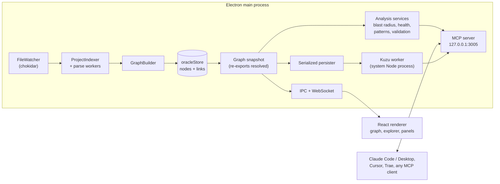

# Architecture

CodeMaps is an Electron app with two jobs that share one graph: draw it for people, and answer questions about it for AI agents over MCP.

## From source files to a graph

1. **Indexing** (`electron/oracle/ProjectIndexer.ts`). Files are parsed in a worker pool (`electron/worker.ts`, piscina) so the main process stays responsive. A per-project cache in the app's user-data folder lets unchanged files be skipped.
2. **Parsing** (`electron/parsing/`). TypeScript, TSX and JavaScript go through the TypeScript compiler API, which resolves imports and records re-exports (`export * from`, `export { a as b } from`). Go, Python, Java and Rust additionally go through per-language fact extractors (`electron/parsing/facts/`) that read the syntax tree for imports, declared package, qualified uses (`pkg.Name`) and used names, and name methods after their type. Other languages use tree-sitter queries (WASM) for declarations and imports. Markdown files can carry architecture decision records (ADR) that are linked to code.
3. **Graph building** (`electron/oracle/GraphBuilder.ts`). Each file becomes a node with its classes and functions as child nodes; imports become links. The store (`electron/store.ts`) keeps nodes and links in a vanilla zustand store.
4. **Import resolution** (`electron/resolution/`). A Go, Python, Java or Rust import names a package or module, not a relative path, so it can only be resolved once the whole project is indexed. After indexing and after every watcher flush, one resolver per language turns the raw facts on the file nodes into links to files and symbols: `go.mod` module paths and same-package references for Go; absolute, relative, `src/`-layout and `__init__` re-exports for Python; package and class lookup (including wildcard and static imports) for Java; Cargo crates, `mod` trees, `use` paths and `pub use` re-exports for Rust. The pass is a full recompute because one added or removed file can change what many imports resolve to; its links carry a `reason` such as `go:import` and are the only ones it ever replaces.
5. **Snapshot** (`electron/store/graphSnapshot.ts`). Links are resolved to real declarations. An import of `./store` that is a barrel re-exporting `./store/types` is followed to the declaring symbol, with a depth limit and cycle guard, so dependents are counted correctly.
6. **Live updates** (`electron/oracle/FileWatcher.ts`). File changes are debounced, re-indexed and folded into the graph. Starting the watcher waits until it is ready, so files created right after analysis are not missed, and `whenIdle()` lets a caller wait for pending changes before reading the graph.

## Duplication and coupling

Duplicated code is found by `electron/analysis/clones/`: every supported file is turned into a stream of normalized tokens (names, numbers and strings are interchangeable), n-gram hashes are winnowed, and matches are extended to maximal copies, across and inside files. Token streams are cached per file in `CloneIndex`, so tools that report clones (`ensureGraphLoaded` awaits the refresh) pay only for the files that changed. `electron/analysis/couplingMetrics.ts` counts fan-in and fan-out in distinct files rather than links, weighs references inside one package at a quarter, and exempts shared-by-design code and entry points from hub, fan-out and layer findings.

## MCP server

`electron/mcp.ts` is an Express app speaking MCP Streamable HTTP on `127.0.0.1` (port `3005`, overridable with `CODEMAPS_MCP_PORT`) plus a WebSocket channel for the UI. It only listens on the loopback interface and accepts browser requests only from loopback origins. If the port is taken the server reports `Unavailable` with the reason instead of crashing the app.

- Tools live in `electron/mcp/register*.ts` and are described once in `electron/mcp/descriptors.ts`; [MCP_TOOLS.md](MCP_TOOLS.md) is generated from those descriptors and a test fails when it is stale.
- Responses are bounded (`electron/mcp/compactPayload.ts`): lists are cut to a limit, long strings shortened, repeated sub-trees replaced by `$sameAs` pointers, and everything omitted is reported under `_compaction`.
- Composite `prepare_*` tools assemble a project, change, review or campaign context so an agent needs one call instead of many.
- `validate_architecture_changes` narrows project-wide findings to the files you changed (`electron/analysis/ChangeValidationService.ts`) and waits for the indexer first.
- A Claude Code hook (`scripts/codemaps-validate-hook.mjs`) calls that tool after each edit and feeds the result back to the agent.

## Kuzu worker

Three tools (`calculate_blast_radius_v2`, `analyze_activity_heatmap`, `analyze_pr_impact`) query the graph with Cypher in [Kuzu](https://kuzudb.com). Kuzu's native module crashes inside Electron's runtime, so it runs in a separate child process under the **system Node** (`electron/services/KuzuNativeProcess.ts`). Because Node cannot read `app.asar`, every file the worker loads is unpacked (`build.asarUnpack`), and a test checks that list.

The database (`<project>/.codemaps/graph.db`) is only a cache of the analysed graph. Saves run one at a time (`createSerializedPersister`), and a database that cannot be opened because it is damaged is moved aside and recreated (`electron/services/KuzuRecovery.ts`).

## Renderer

`src/` is a React app with zustand stores.

- **Layout** (`src/utils/layoutEngine.ts`): elkjs computes either a nested _hierarchy_ (box layout) or a layered _dependencies_ graph. The dependency overview uses Brandes-Koepf placement because network-simplex took seconds on a whole project.
- **Viewport** (`src/hooks/useGraphViewport.ts`): frames the graph on open, follows window size until the user pans or zooms, and centres a selected node.
- **Details** (`src/utils/nodeSummary.ts`): folds symbol-level links into files so the "used by / depends on" lists stay readable.
- **i18n** (`src/i18n/locales/`): English, Russian and Chinese; a test enforces identical keys.

## Design rules worth knowing

- **Derived data is disposable.** The graph is rebuilt from sources; caches and the Kuzu database can always be deleted.
- **Nothing blocks the UI.** Parsing is in workers, graph queries in a child process, and a regression test fails if the dependency layout becomes slow.
- **Agent-facing output is budgeted.** Adding a tool means describing it in `descriptors.ts`, translating it in the three locale files, and classifying it in `docsGenerator.ts`; tests enforce each step.
- **Verify in a fresh clone.** `npm run verify` is what CI runs; untracked or git-ignored files and Windows-only path assumptions pass locally and fail on CI.
